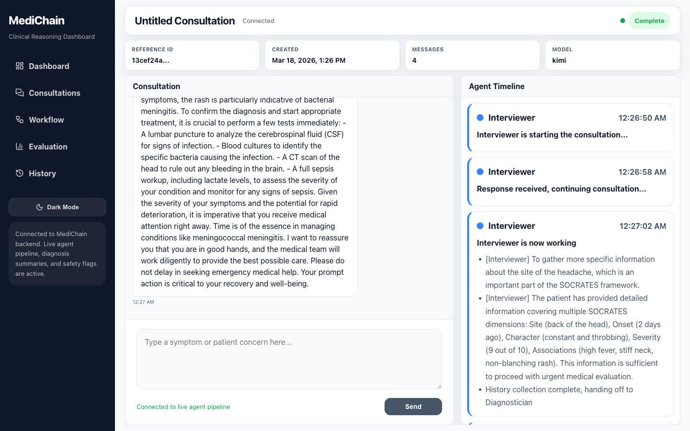
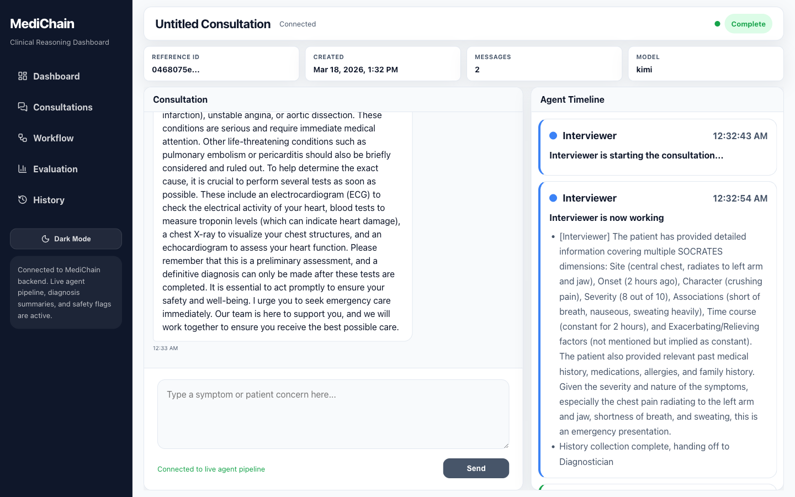
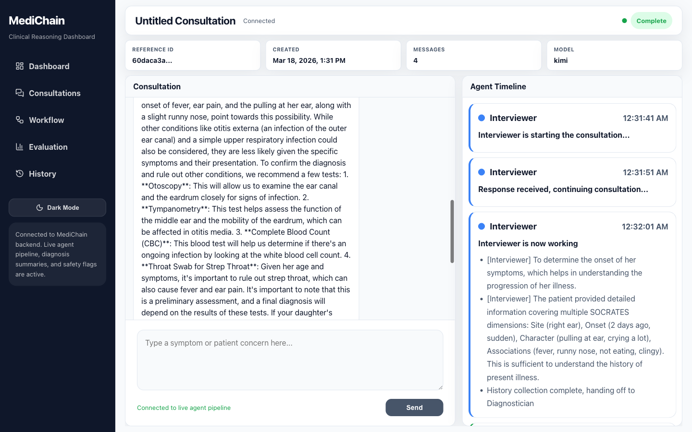

# MediChain: Multi-Agent Clinical Diagnostic Reasoning

A multi-agent LLM system that takes a patient's description of their symptoms, runs a structured
diagnostic debate between specialised agents, checks the result against deterministic clinical risk
scores, and returns a plain-language assessment with an emergency warning when one is needed.

Built as a group project by a team of six over three agile sprints, with client review meetings and demos guiding each iteration. Shared here with the team's agreement.

> Research prototype. Not a medical device and not a substitute for professional medical advice.



**Stack:** Python 3.12 · LangGraph · FastAPI (REST + WebSocket) · PostgreSQL · Redis · ChromaDB (RAG) ·
FastMCP · React 18 + TypeScript + Vite + Tailwind · Docker Compose · GitHub Actions

---

## My role: Project coordinator and Prompt & LLM Engineer (Danni Cai)

I coordinated the project: I was the team's main contact with the client, assigned tasks to team members
and followed up on progress each week across the three sprints.

I designed and iterated the system prompts for every LLM step in the pipeline. All six live in
[`prompts/`](prompts/) and are used in the final version:

| Prompt | What it makes the model do |
|---|---|
| [`interviewer_prompt.py`](prompts/interviewer_prompt.py) | SOCRATES history-taking. Asks 3 to 5 questions in **one batch** across different dimensions, stops after 3+ dimensions are covered or 2 rounds, and fast-tracks emergency red flags. |
| [`diagnostician_prompt.py`](prompts/diagnostician_prompt.py) | Ranked differential (3+ diagnoses) with **calibrated confidence** (85+ only for classic presentations), supporting and against evidence, sources, next tests. |
| [`critic_debate_prompt.py`](prompts/critic_debate_prompt.py) | Issues **typed, evidence-backed challenges** (missed diagnosis, evidence gap, scoring error, safety concern) and **no challenge** when the differential is adequate. |
| [`diagnostician_debate_prompt.py`](prompts/diagnostician_debate_prompt.py) | Answers each challenge with accept, refute or partially accept, with evidence, and is told not to agree just to be agreeable. |
| [`coordinator_prompt.py`](prompts/coordinator_prompt.py) | Patient-facing synthesis. **Emergency warning goes above everything else** when the safety flag is red. |
| [`cdss_prompt.py`](prompts/cdss_prompt.py) | Picks which clinical scores apply and extracts their parameters strictly from the history, never inventing vitals or labs. |

The design decisions behind each prompt, and the problems they address, are written up in
**[docs/prompt-design.md](docs/prompt-design.md)**.

I also wrote the backend test suite in [`tests/`](tests/): 212 pytest tests, including 37 regression tests for 12 defects I found in a code review, run by GitHub Actions on every push.

Earlier in the project I built the original multi-provider LLM factory ([`models/llm_factory.py`](models/llm_factory.py): Groq, OpenAI, Gemini), which the main pipeline later replaced with `agents/base.py`.

---

## How it works

```
Patient ──► Interviewer ──► Diagnostician ──► CDSS node ──► Debate ──────► Coordinator ──► Response
            (SOCRATES,       (RAG over        (6 risk       Critic ⇄        (plain language,
             batch Qs)        medical KB)      scores)      Diagnostician    emergency first)
                                                            ≤ 2 rounds, stops early on consensus
```

1. **Interviewer** collects the history and hands a structured summary on.
2. **Diagnostician** builds a ranked differential, grounded in passages retrieved from a ChromaDB medical knowledge base.
3. **CDSS node** has the LLM choose relevant scores, then computes them deterministically: Wells, CURB-65, CHA₂DS₂-VASc, HEART, qSOFA, PHQ-9, plus RxNorm drug-interaction lookup. The same tools are exposed as a standalone MCP server (`python -m cdss.mcp_server`).
4. **Debate**: the Critic raises typed challenges and the Diagnostician accepts, refutes or partially accepts each one, revising the differential. Capped by `MAX_DEBATE_ROUNDS` (default 2).
5. **Coordinator** writes the final answer for the patient.

Every agent step is streamed to the UI over WebSocket (`/ws/{session_id}`) and shown in the Agent Timeline.

| Chest pain (single detailed message) | Child with ear pain (parent reporting) |
|---|---|
|  |  |

---

## Evaluation

The harness in [`harness/`](harness/) scores the pipeline against 7 ground-truth cases (meningitis,
UTI, ACS chest pain, anxiety with somatic symptoms, chronic fatigue, child ear infection, moderate
pneumonia). Live run on 2026-04-21 with Kimi (`kimi-latest`):

| Metric | Result |
|---|---|
| Top-1 accuracy | 100% (7/7) |
| Top-3 recall | 100% (7/7) |
| Safety recall | 85.7% (1 of 7 critical findings missed) |
| Average debate rounds | 1.0 |
| Challenge acceptance rate | 100% |

How to read these numbers:

- **Seven cases is a small set.** They cover the core paths (emergency, routine, paediatric, mental health) but do not show robustness across specialties.
- **Only one model was tested.** The code supports Kimi, Groq (Llama 3.3 70B), OpenAI (GPT-4o) and Gemini 2.0 Flash, but no side-by-side comparison was run.
- **A 100% acceptance rate is a warning sign, not a win.** The Diagnostician accepted every challenge despite being told to defend when warranted. Whether that reflects good challenges or sycophancy needs more cases to tell apart.

Backend: 212 pytest tests (plus 3 opt-in live tests), 57% overall coverage with `agents/debate.py` at 93% and
`cdss/scoring.py` at 94%. Frontend: 21 Vitest tests. Both run in CI on every push.

---

## Quick start

You need Docker (with Compose v2) and an API key for at least one LLM provider.

```bash
git clone https://github.com/421D/medichain-multi-agent.git
cd medichain-multi-agent
cp .env.example .env          # set MEDICHAIN_LLM_MODEL and the matching *_API_KEY

# Full stack: backend + frontend + Postgres + Redis
mv docker-compose.override.yml docker-compose.override.yml.bak
docker compose up -d --build
```

- UI: http://localhost:8080
- API docs (Swagger): http://localhost:8000/docs

The medical knowledge-base corpora (StatPearls and MedRAG textbooks, about 670 MB) are not in the repo.
See [docs/rag_guide.md](docs/rag_guide.md) and place the JSONL files in `data/`. Without them the pipeline
still runs, but the Diagnostician gets no retrieved references.

Full install guide, local development setup and troubleshooting: [INSTALL.md](INSTALL.md).

### Without an API key

```bash
pip install -r requirements.txt
python demo_orchestration.py      # scripted walk-through of the debate pipeline
pytest -q                         # 212 passed, 3 deselected
cd frontend-v3-creative && npm install --legacy-peer-deps && npm test
```

### Evaluation harness

```bash
python -m harness.run --live            # real LLM calls on all 7 cases, writes reports/
python -m harness.run --live --case EVAL-003
python -m harness.run --offline         # smoke-tests the scoring code only (mock outputs, scores are 0)
```

### Configuration

| Variable | Default | Purpose |
|---|---|---|
| `MEDICHAIN_LLM_MODEL` | `kimi` | `kimi`, `groq`, `openai` or `gemini` |
| `KIMI_API_KEY`, `GROQ_API_KEY`, `OPENAI_API_KEY`, `GEMINI_API_KEY` | | Provider keys (only the selected one is needed) |
| `MAX_DEBATE_ROUNDS` | `2` | Cap on Critic ⇄ Diagnostician rounds |
| `CORS_ORIGINS` | localhost 8080, 5173, 3000 | Allowed frontend origins |

---

## Project structure

```
agents/            LangGraph nodes: interviewer, diagnostician, cdss_node, debate, coordinator; base.py = multi-provider LLM helper
orchestrator/      Graph topology and shared state
prompts/           System prompts for every LLM step
cdss/              Clinical scores, RxNorm drug interactions, FastMCP server
rag/               ChromaDB knowledge base and cached retriever
harness/           Ground-truth cases, metrics, report generator
app/               FastAPI app: REST routes, WebSocket, async SQLAlchemy, tracing
models/            Pydantic schemas for every inter-agent message
alembic/           Database migrations
frontend-v3-creative/  React UI: consultations, agent timeline, workflow, evaluation, tools
tests/             Backend tests
mcp_server.py      Research MCP server (PubMed lookups used by /api/v1/tools)
demo_orchestration.py  Offline CLI demo
```

---

## Team

Built with five other team members, who developed the LangGraph orchestration, the RAG pipeline and CDSS scoring, the FastAPI backend and deployment, and the React frontend.

## Limitations and future work

- Expand the evaluation set from 7 to 30+ cases across more specialties.
- Run a side-by-side comparison of the four supported LLMs on accuracy, safety recall, latency and cost.
- Investigate the 100% challenge acceptance rate (possible sycophancy in the debate).
- Rare diseases are poorly covered by the current knowledge base.
- A full consultation chains several LLM calls, so end-to-end latency is noticeable even with streaming.
